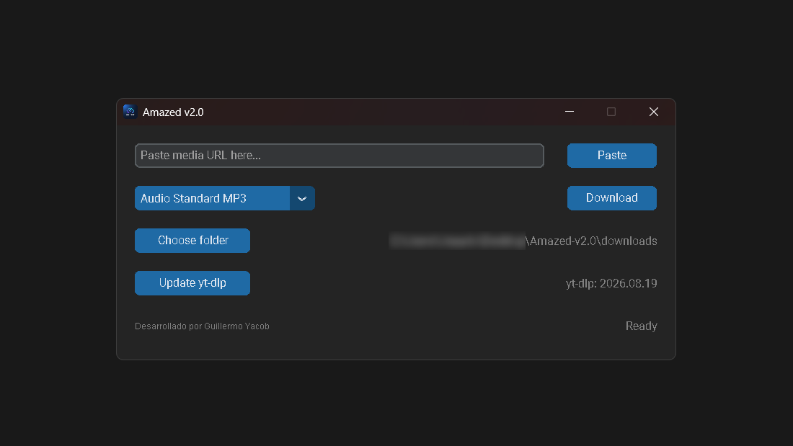
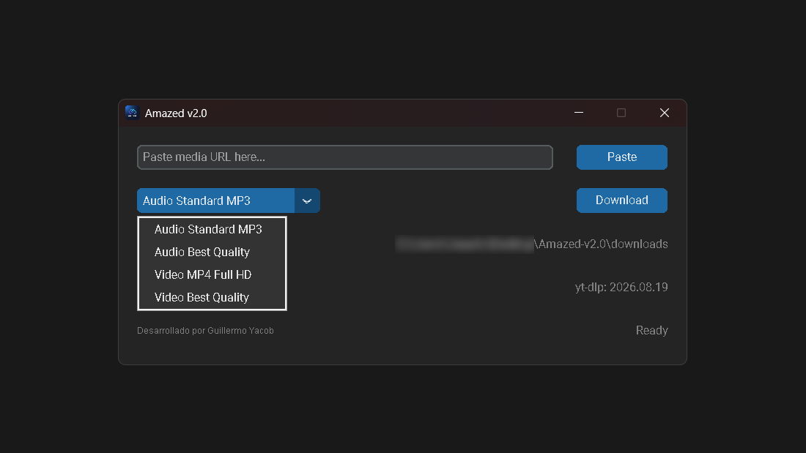
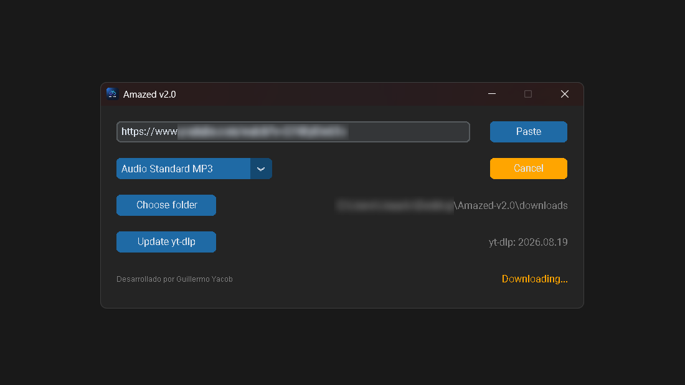
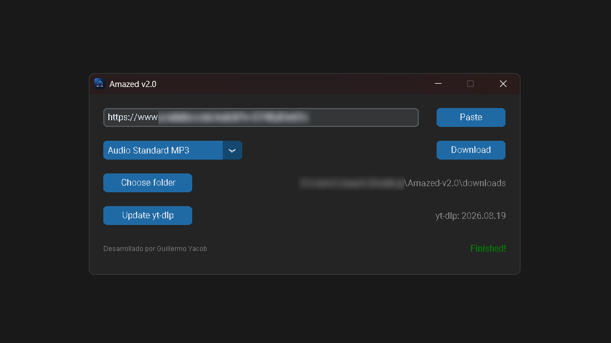

# Amazed - Media Downloader

  

## English

Amazed is a lightweight, minimalist and portable media downloader for Windows.

It is built with Python and CustomTkinter. It provides a graphical interface for [yt-dlp](https://github.com/yt-dlp/yt-dlp), making media downloads easier without having to use the command line.

### Screenshots









### Features

- **Multiple download options:** 

    - Audio Standar MP3
    - Audio Best Quality M4A
    - Video MP4 Full HD (1080p)
    - Video Best Quality

- **Portable:** Amazed is a portable application. Simply extract the ZIP file and place the required tools alongside the executable.
- **yt-dlp updater:** Check for and install yt-dlp updates from within the application.
- **Custom download location:** Choose where downloaded files are saved.
- **Download cancellation:** Cancel an active download.
- **Long-download warning:** Shows a warning after two minutes of continuous downloading, then every five minutes, with the option to continue or stop.
- **Metadata and subtitles:** Supports embedding metadata, thumbnails, chapters and subtitles where available.

### Requirements

Amazed requires the following external executables, which are **not included** in this repository or in the releases:

- [yt-dlp](https://github.com/yt-dlp/yt-dlp/releases) — Handles media downloads.
- [FFmpeg](https://github.com/BtbN/FFmpeg-Builds/releases) — Handles media processing and conversion. Amazed requires `ffmpeg.exe` and `ffprobe.exe`, which can be found inside `ffmpeg-master-latest-win64-gpl.zip`.

Those three files must be placed in the app folder.

The release zip file also includes a `README.txt` setup guide that details these instructions.

### Download

Get the latest version from the [Releases](https://github.com/guillermoyacob/amazed/releases) page.

### Development

These instructions are for running the source code and building Amazed on Windows.

**1. Clone the repository**

```powershell
git clone https://github.com/guillermoyacob/amazed.git
cd amazed
```

**2. Create and activate a virtual environment**

```powershell
python -m venv .venv
.venv\Scripts\activate
```

**3. Install the dependencies**

```powershell
python -m pip install -r requirements.txt
python -m pip install pyinstaller
```

**4. Run from source**

```powershell
python amazed.py
```

**5. Build the executable**

```powershell
python -m PyInstaller --noconsole --onefile --icon="assets/icono.ico" --add-data "assets/icono.ico;." amazed.py
```

The executable will be created in the `dist` folder. The external tools `yt-dlp.exe`, `ffmpeg.exe` and `ffprobe.exe` are still required alongside the built executable for normal use.

### License

The Amazed source code is licensed under the [MIT License](LICENSE).

The **Amazed name and logo are not covered by the MIT License** and are reserved by the author.

Amazed uses external tools maintained by other projects. It is not affiliated with or endorsed by the yt-dlp or FFmpeg projects.

---

## Español

Amazed es un programa ligero, minimalista y portable para descargar contenido multimedia en Windows.

Está desarrollado con Python y CustomTkinter. Ofrece una interfaz gráfica para [yt-dlp](https://github.com/yt-dlp/yt-dlp), facilitando las descargas sin necesidad de utilizar una consola comandos.

### Capturas de pantalla


### Características

- **Múltiples opciones de descarga:** 

    - Audio Estándar MP3
    - Audio Mejor Calidad M4A
    - Video MP4 Full HD (1080p)
    - Video Mejor Calidad

- **Portable:** Amazed es un programa portable. Simplemente extraé el archivo ZIP y colocá las herramientas necesarias junto al ejecutable.
- **Actualizador de yt-dlp:** Permite comprobar e instalar actualizaciones desde la propia aplicación.
- **Ubicación de descarga personalizada:** Elegí dónde guardar los archivos descargados.
- **Cancelación de descargas:** Cancelá una descarga en curso.
- **Aviso por descargas prolongadas:** Muestra un aviso después de dos minutos de descarga continua y luego cada cinco minutos, con la opción de continuar o detener la descarga.
- **Metadatos y subtítulos:** Permite incrustar metadatos, miniaturas, capítulos y subtítulos cuando están disponibles.

### Requisitos

Amazed necesita los siguientes ejecutables externos, que **no están incluidos** en este repositorio ni en los lanzamientos:

- [yt-dlp](https://github.com/yt-dlp/yt-dlp/releases) — Gestiona las descargas de medios.
- [FFmpeg](https://github.com/BtbN/FFmpeg-Builds/releases) — Se encarga del procesamiento y la conversión de medios. Amazed necesita `ffmpeg.exe` y `ffprobe.exe`, que se encuentran dentro del archivo llamado `ffmpeg-master-latest-win64-gpl.zip`.

Esos tres archivos deben ser colocados en la carpeta del programa.

El archivo zip de la publicación también incluye una guía `README.txt` que detalla estas instrucciones.

### Descarga

Obtené la última versión desde la sección de [Releases](https://github.com/guillermoyacob/amazed/releases).

### Desarrollo

Estas instrucciones sirven para ejecutar el código fuente y compilar Amazed en Windows.

**1. Clonar el repositorio**

```powershell
git clone https://github.com/guillermoyacob/amazed.git
cd amazed
```

**2. Crear y activar un entorno virtual**

```powershell
python -m venv .venv
.venv\Scripts\activate
```

**3. Instalar las dependencias**

```powershell
python -m pip install -r requirements.txt
python -m pip install pyinstaller
```

**4. Ejecutar desde el código fuente**

```powershell
python amazed.py
```

**5. Compilar el ejecutable**

```powershell
python -m PyInstaller --noconsole --onefile --icon="assets/icono.ico" --add-data "assets/icono.ico;." amazed.py
```

El ejecutable se creará en la carpeta `dist`. Para utilizarlo normalmente, también necesitarás los archivos externos `yt-dlp.exe`, `ffmpeg.exe` y `ffprobe.exe` junto al ejecutable compilado.

### Licencia

El código fuente de Amazed está bajo la [Licencia MIT](LICENSE).

El **nombre y el logotipo de Amazed no están cubiertos por la Licencia MIT** y están reservados por su autor.

Amazed utiliza herramientas externas mantenidas por otros proyectos. No está afiliado ni cuenta con el respaldo de los proyectos yt-dlp o FFmpeg.
